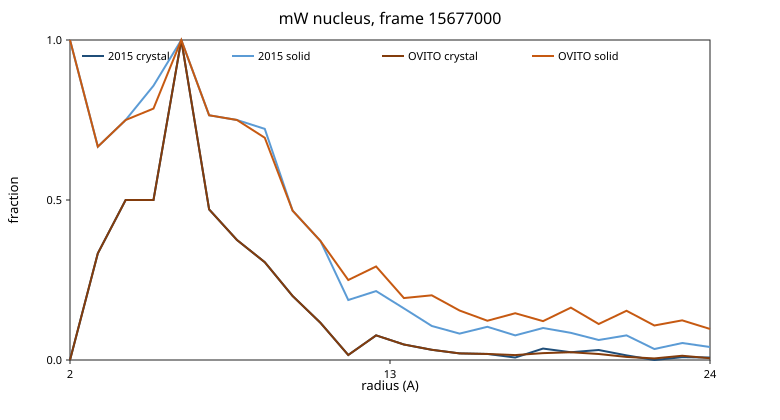
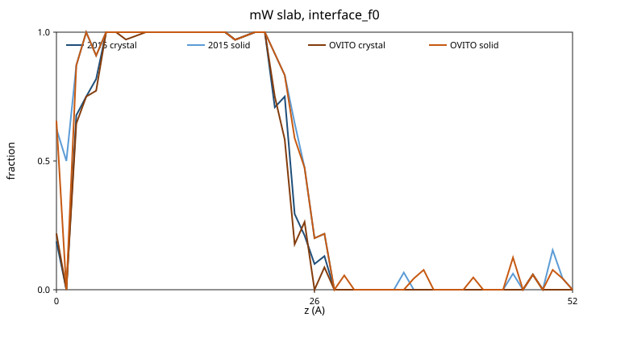
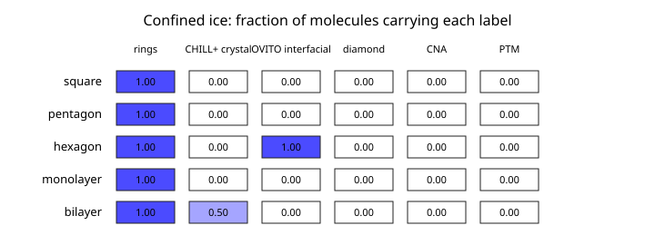
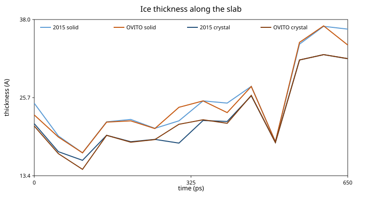

#+TITLE: Interface and confined ice
#+OPTIONS: toc:nil num:nil

Two published CHILL+ rules, on the same coordinates, with the
thresholds left alone.
The neighbour test and the ~q3~ shell are what move the labels.
The open edges do not, on these frames.
Prism blocks and sheet rings name confined ice that CHILL+, the
diamond test, adaptive common-neighbour analysis and a tetrahedron
template do not.

The counts below come from ~interface_order~ on commit ~2f96e7bd~
plus the comparison in this tree.
Ideal ice Ih (~input/traj/ice1h.lammpstrj~, 128 molecules) is
hexagonal under both rules, with no disagreements.

* The two rules

Nguyen and Molinero, J. Phys. Chem. B 119 (2015) 9369, equation 1
averages ~q3~ over the four nearest neighbours.
A staggered bond is ~c(i,j) <= -0.8~.
An eclipsed bond is ~-0.35 <= c(i,j) <= 0.25~.
Table 1 gives a crystal or clathrate label only when four neighbours
lie inside the cutoff.
Footnote a of that table keeps the interfacial neighbour test.
Two staggered bonds need a neighbour with more than two staggered
bonds.
Three staggered bonds and no eclipsed bond need a neighbour with
more than one staggered bond.

The OVITO 3.17.2 manual
([[https://docs.ovito.org/reference/pipelines/modifiers/chill_plus.html][Chill+]])
states the same cutoff and the same four-bond rows, and then differs
in three places.
A staggered bond is a correlation less than ~-0.8~.
An eclipsed bond lies between ~-0.35~ and ~0.25~.
Interfacial ice is "4 bonds of which 2 or 3 staggered", with
hexagonal ice preferred when the fourth bond is eclipsed.
The neighbour test is not stated.

mdapy's Chill+ kernel (cross-checked there against OVITO's
~ChillPlusModifier~) is the same statement in code.
~q3~ is summed over every neighbour inside the cutoff, not over the
four nearest.
The inequalities are strict.
A row is classified only when the coordination is 4.
Two staggered bonds, or three staggered and no eclipsed bond, are
interfacial, with no look at the neighbour.

~chill+~ in this tree is the 2015 rule.
~ovito-chill+~ is the OVITO/mdapy rule.
Neither threshold is changed.
The comparison turns one lever at a time: the neighbour test, then
the ~q3~ shell, then the open edges.
An atom is counted under the lever that first produces the OVITO
label.
If more than one lever moves the label, the atom is mixed.

On both frames below, every atom that changes label has exactly four
neighbours inside 3.5 Å.
The shell gate of Table 1 is not the split.
Widening ~q3~ changes the label of a four-coordinated molecule when
one of its neighbours has a further neighbour inside the cutoff.
The open edges move no atom on either frame.
No correlation in these two frames sits on ~-0.8~, ~-0.35~ or ~0.25~.

* Nucleus

Frame 1 of ~input/traj/nucleation_f1.lammpstrj~ (timestep 15677000,
4096 mW molecules).
The two rules disagree on 397 molecules.

| lever | molecules |
|-------+-----------|
| neighbour test | 201 |
| ~q3~ shell | 192 |
| open edge | 0 |
| both levers | 4 |

| label | 2015 | OVITO |
|-------+------|-------|
| cubic | 47 | 48 |
| hexagonal | 62 | 54 |
| interfacial | 240 | 478 |
| clathrate | 20 | 21 |
| interfacial clathrate | 138 | 135 |
| water | 3589 | 3360 |

The largest single move is water to interfacial, 254 molecules.
Interfacial water in the other direction is 27.
Hexagonal to interfacial is 12.
Interfacial clathrate to water is 41.
Water to interfacial clathrate is 37.
The crystal core barely moves.
The liquid's interfacial count almost doubles, from 5.86% to 11.7%
of the box.
The solid fraction, crystal plus interfacial, goes from 8.52% to 14.2%.

All 397 molecules are in the four-neighbour shell.
Of the molecules that do not change label, 1927 also have four
neighbours, 1428 have five, 289 have six and 38 have seven or more.
Seventeen have three.
The extra neighbours sit on the agreeing population.
They change a neighbour's ~q3~, and that is the shell lever.

Ring membership does not separate the 397.
395 of them lie on a primitive 6-ring, 381 on a 5-ring and 111 on a
4-ring, on the 3.5 Å graph.
The agreeing population is 3657, 3583 and 1957 on those same rings.
No prism block and no bilayer sheet is present.

The crystal radius, read outward from the shell of highest crystal
fraction to the 0.5 crossing, is 6.44 Å under both rules.
The 10-90 width of that crystal front is 4.97 Å under both rules.
The solid radius is 9.37 Å (2015) and 9.35 Å (OVITO).
The 10-90 width of the solid front, measured from the centre of mass,
is 13.0 Å under the 2015 rule and 22.6 Å under OVITO.
The OVITO solid fraction is still about 0.10 in the outer liquid, so
that width is the slow decay of interfacial labels through the
liquid, not a thicker crystal.

The same frame has an instantaneous surface in the sense of Willard
and Chandler, J. Phys. Chem. B 114, 1954 (2010).
The coarse-graining Gaussian has their width, ξ = 2.4 Å.
Rays leave the centre of mass of the 2015 crystal.
The surface on a ray is where the coarse density crosses the midpoint
of the core and the outer liquid.
280 of 288 rays cross.
The mean radius is 5.49 Å and the root-mean-square deviation of the
surface about that mean is 5.02 Å.
The 10-90 width of the coarse density, measured along the local
normal of that surface, is 3.52 Å.
On the same coordinate the 2015 solid fraction has a 10-90 width of
3.07 Å and the OVITO solid fraction has 3.18 Å.
The 13.0 Å and 22.6 Å widths are the centre-of-mass profiles.
They fold in the 5.02 Å roughness of the surface and, for OVITO, the
interfacial labels in the outer liquid.
Neither is the intrinsic width.
Adaptive common-neighbour analysis calls all 4096 molecules other.
The diamond test calls 3 cubic and 5 hexagonal.
A tetrahedron template with RMSD below 0.1, the OVITO polyhedral
template matching cutoff, passes 817 molecules, of which 119 are in
the disagreeing set.
Mean ~q6~ is 0.540 on the disagreeing set and 0.489 on the rest.
Bulk ice Ih in the test set has mean ~q6~ 0.626.

* Slab

~input/traj/interface_f0.lammpstrj~ is 864 mW molecules in a box of
22.99 × 21.61 × 52.51 Å.
The long axis is the surface normal.
The two rules disagree on 46 molecules.

| lever | molecules |
|-------+-----------|
| neighbour test | 5 |
| ~q3~ shell | 41 |
| open edge | 0 |
| both levers | 0 |

| label | 2015 | OVITO |
|-------+------|-------|
| cubic | 1 | 1 |
| hexagonal | 352 | 346 |
| interfacial | 49 | 57 |
| clathrate | 3 | 3 |
| interfacial clathrate | 25 | 20 |
| water | 434 | 437 |

The net interfacial count rises by 8, from 5.67% to 6.60%.
Forty-six labels move, in both directions.
Hexagonal to interfacial is 10.
Interfacial to water is 5 and interfacial to hexagonal is 4.
Interfacial clathrate to water is 10.
The solid fraction is 0.465 and 0.468.
The crystal fraction is 0.409 and 0.402.

The 2015 solid slab is 24.82 Å thick, between Gibbs surfaces at
0.30 Å and 25.11 Å.
The 10-90 widths are 3.04 Å and 5.29 Å.
The OVITO solid slab is 22.98 Å thick, between 2.05 Å and 25.04 Å.
The widths are 1.10 Å and 5.29 Å.
One surface stays put.
The other moves by 1.76 Å, and that is the whole of the thickness
change.
The crystal slab, cubic plus hexagonal only, is 21.61 Å (2015) and
21.23 Å (OVITO).

The 46 molecules sit on average 5.33 Å from the nearest 2015 solid
surface.
The other 818 sit 6.67 Å away.
The shift is real and small.
Bins on the two surfaces hold part of the 46, and the rest are
scattered through the liquid, one or two molecules in a 1 Å bin.
All 46 have four neighbours inside 3.5 Å.
Forty-five lie on a 6-ring.
There is no prism and no bilayer.

Adaptive common-neighbour analysis calls every molecule other.
The diamond test calls 143 hexagonal and none cubic.
The tetrahedron template passes 346 molecules, 8 of them in the
disagreeing set.
Mean ~q6~ is 0.527 and 0.511.

* Confined ice

The frameworks are ideal oxygen sites at a nearest-neighbour
distance of 2.75 Å.
A nanotube is a stack of 8 rings in a box whose long axis is the
tube.
A sheet is a rectangular honeycomb, one layer or two.
The second layer is shifted by one bond in the plane, which is the
graphite AB stacking, and separated by 2.75 Å.
Half the bilayer molecules then have three neighbours and half have
four.
~iface::nanotube~ and ~iface::honeycombSheet~ build them.
No trajectory is stored.

| framework | N | 2015 | OVITO | rings | diamond | CNA | PTM | ~q6~ |
|-----------+---+------+-------+-------+---------+-----+-----+------|
| square tube | 32 | water 32 | water 32 | prism 32, 8 blocks | 0 | 0 | 0 | 0.424 |
| pentagon tube | 40 | water 40 | water 40 | prism 40, 8 blocks | 0 | 0 | 0 | 0.487 |
| hexagon tube | 48 | water 48 | interfacial 48 | prism 48, 8 blocks | 0 | 0 | 0 | 0.509 |
| monolayer | 48 | water 48 | water 48 | polygon 48 | 0 | 0 | 0 | 0.741 |
| AB bilayer | 96 | cubic 48, water 48 | cubic 48, water 48 | bilayer 96 | 0 | 0 | 0 | 0.622 |

The hexagon tube is the neighbour test on its own.
Every molecule has four neighbours and an interfacial bond count.
Footnote a fails for all 48, so the 2015 rule leaves them as water.
OVITO labels all 48 interfacial.
The prism blocks are the same eight basal pairs either way.
Square and pentagon tubes are water under both rules.
Their bond angles are not the staggered ice pattern.
The prism blocks still name the tube.
The monolayer has three neighbours, so both CHILL+ rules say water
before any bond test.
Every molecule is on a planar 6-ring.
Its mean ~q6~ is 0.741, above the 0.626 of bulk ice Ih, so a ~q6~
threshold taken from bulk ice does not reject the sheet.
The AB bilayer is split by coordination.
The four-coordinated sublattice is cubic under both CHILL+ rules.
The diamond test, adaptive common-neighbour analysis and the
tetrahedron template call none of the 96 a crystal.
The bilayer rings cover all 96, and there is no prism.

Adaptive common-neighbour analysis is the Stukowski test: 12
neighbours for FCC, HCP and icosahedral, 14 for BCC, with the
adaptive cutoff ~(1+sqrt(2))/2~ times the mean neighbour distance.
The diamond test is the second-shell common-neighbour test used for
cubic and hexagonal diamond.
The template is the four unit vectors of a tetrahedron, accepted
when the best rigid match has RMSD below 0.1.
~q6~ is the Steinhardt invariant on the 3.5 Å shell, the quantity
~freud.order.Steinhardt(l=6)~ returns for that neighbour list.

* Growth

The campaign is ~input/interface/campaign.py~.
It starts from ~interface_f0.lammpstrj~, the mW Stillinger-Weber
potential, a 10 fs step, and NVT at the volume of that frame.
Four velocity seeds, numbered 1 to 4, run at 240, 250, 260 and 270 K.
The velocity seed is ten times the temperature plus the replica, so
the sixteen streams differ.
Frames are kept every 10 ps for 800 ps.
The trajectories are not committed.
The slope on a seed is ordinary least squares of the solid thickness
while the 2015 solid fraction lies between 0.15 and 0.90 and both
thicknesses are still defined.
The mean of the four seeds is a percentile bootstrap, 10000 draws,
Hyndman-Fan type 7, generator seed 270.
The interval is the 2.5 and 97.5 percentiles.
The difference is the 2015 rate minus the OVITO rate on the same
seed, resampled by the shared seed index.
It excludes zero when those two percentiles lie on the same side of
zero.

This session had 8 cores.
Each LAMMPS run used one OpenMP thread.
The sixteen runs finished in 207.4 s of wall time.
The individual runs took 89.4 to 115.2 s.
Scoring the trajectories with ~interface_order growth~ took 13.3 s
for those sixteen files and 20.0 s when 272 K and 273 K were added,
one thread per scoring process, run serially.

The thickness below is the ice slab, so it is the sum of the two
fronts.
Half of it is the mean advance of one front.
Espinosa, Navarro, Sanz, Valeriani and Vega, J. Chem. Phys. 145,
211922 (2016), Table I, give the secondary-prismatic growth rate of
mW as one front, u = L / (2 τ), in Å/ns.
Their melting point for mW is 274.6 K.
The table does not list 270 K.
Converted, 490 Å/ns is 49 m/s, 375 Å/ns is 37.5 m/s and 266 Å/ns is
26.6 m/s.

| T (K) | 2015 slab (Å/ps) | OVITO slab (Å/ps) | 2015 one front (m/s) | OVITO one front (m/s) | Espinosa Table I (m/s) |
|-------+------------------+-------------------+----------------------+-----------------------+------------------------|
| 240 | 0.269 [0.224, 0.312] | 0.287 [0.237, 0.334] | 13.5 | 14.4 | 49 |
| 250 | 0.174 [0.148, 0.200] | 0.183 [0.151, 0.213] | 8.72 | 9.15 | 37.5 |
| 260 | 0.143 [0.128, 0.159] | 0.148 [0.132, 0.164] | 7.16 | 7.39 | 26.6 |
| 270 | 0.0292 [0.0137, 0.0569] | 0.0299 [0.0139, 0.0584] | 1.46 | 1.49 | not listed |

Shi, Fulford, Salvalaglio and Molteni, arXiv:2410.07050
(12 January 2025), report that the mW basal and prism1 rates both
peak at 240 K, and that those rates are two orders of magnitude
above their TIP4P/Ice rates.
The TIP4P/Ice rates in that preprint run from 0.2 to 0.9 Å/ns, with
the 260 K maxima 0.621 ± 0.104 Å/ns on the basal face and
0.840 ± 0.033 Å/ns on prism1.
A one-front rate of 13.5 m/s is 135 Å/ns, which sits about two
orders above that TIP4P/Ice maximum.
It is smaller than the Espinosa secondary-prism value at the same
temperature.
The two calculations are not the same slab: Espinosa used a direct
coexistence cell of about 4000 molecules and the secondary prismatic
plane, and this campaign uses the 864-molecule frame at fixed volume.
The ordering with temperature is the same.
Both are fastest at 240 K and slower at 260 K.

The paired difference, 2015 minus OVITO, excludes zero at 240, 250,
260 and 270 K.

| T (K) | difference (Å/ps) | excludes zero |
|-------+-------------------+---------------|
| 240 | −0.0179 [−0.0217, −0.0140] | yes |
| 250 | −0.00854 [−0.0130, −0.00395] | yes |
| 260 | −0.00466 [−0.00733, −0.00245] | yes |
| 270 | −0.00067 [−0.00154, −0.00015] | yes |
| 272 | −0.00015 [−0.00058, 0.00032] | no |
| 273 | −0.00028 [−0.00054, 0.00001] | no |

272 K and 273 K are four further seeds each, on the same deck, run
to see where the interval reaches zero.
It does so at 272 K.
The crystal thickness, cubic plus hexagonal and not the interfacial
label, already has an interval that includes zero at 240, 260 and
270 K.
The solid-thickness difference is the one carried by the interfacial
label, and that difference stops excluding zero at 272 K.

* Reproduce

#+begin_src sh
interface_order study input/traj/nucleation_f1.lammpstrj
interface_order study input/traj/interface_f0.lammpstrj
interface_order confined
python3 input/interface/campaign.py
python3 scripts/growth_rates.py --bin bbdir-eessi/tests/interface_order
interface_order wc input/traj/nucleation_f1.lammpstrj
python3 scripts/figures_interface_order.py \
  --bin bbdir-eessi/tests/interface_order \
  --growth data/interface/growth.lammpstrj --dt 50
#+end_src

The figures are the nucleus profile, the slab profile, the confined
label grid and, when a trajectory is passed, the ice thickness.

Solid means cubic, hexagonal and interfacial.
Crystal means cubic and hexagonal only.
